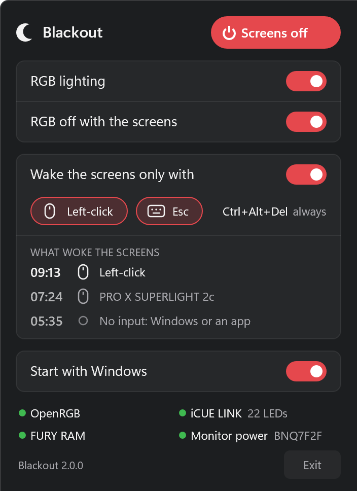
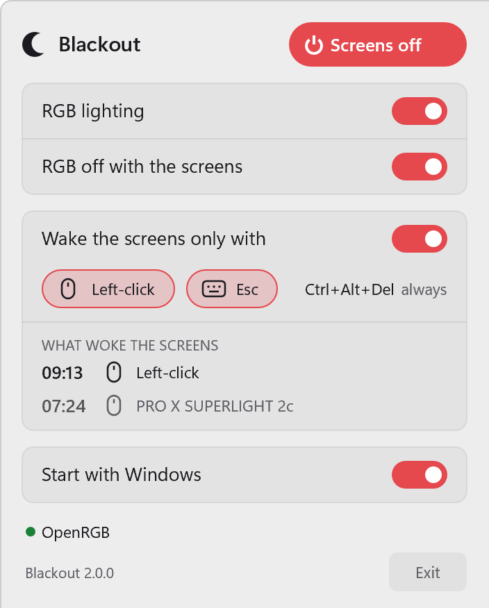
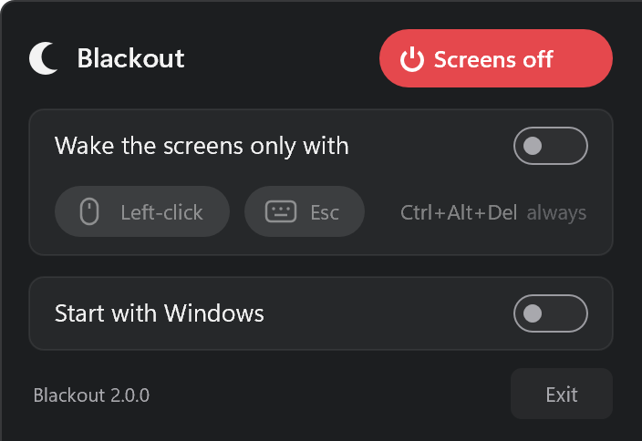

# Blackout

A tiny Windows tray app. Click it and every screen turns off. Lighting, monitor power and window positions follow the screens, and you choose what may wake them.

One small exe. No installer, no driver, no admin rights, no service. It works with no setup at all, and every extra is optional.

## What it does

| Screens off | Screens on |
|---|---|
| RGB off | RGB back on |
| Listed monitors powered off over DDC/CI | Those monitors powered on |
| Window positions saved | Windows put back where they were |
| Only the inputs you chose can wake the screens | The wake is logged with the device behind it |

This works for a Blackout click and for Windows' own display timeout.

**Left-click** the icon: screens off.
**Right-click**: the Blackout panel. It sits flush against the taskbar and the screen edge like the system tray menus, and takes its colour from your taskbar.

<p>



</p>

The panel is one view and shows only what is set up on your PC:

- **Screens off.**
- **RGB lighting** and **RGB off with the screens**, once lighting is set up. RGB set to off stays off: waking the screens only brings the lighting back if the RGB switch is on.
- **Wake the screens only with** a left-click, Esc, or both, and under it what woke the screens last.
- **Start with Windows**, what Blackout found on this PC (green: working, amber: the line says what is wrong), the version and Exit.

The third picture is a PC with no `blackout.ini`. Esc closes the panel. If Direct2D is unavailable, a plain menu appears instead.

## Coming from 1.x

Fan control and GPU overclock profiles moved to [Central Command](https://github.com/Xipzer/central-command), and their settings carry over there.
Blackout 2 ignores the `[fans]` and `[gpu]` sections of an existing `blackout.ini` and the old values in the registry, so nothing has to be cleaned up.
One thing is left over if 1.x ran as admin: its `Blackout` logon task, which Blackout 2 neither uses nor removes (delete it in Task Scheduler, then switch **Start with Windows** on).

## Supported hardware

| Feature | Hardware | Needs |
|---|---|---|
| Screens off, wake rules, wake log, window restore | Any PC with Windows 10 (1703 or later) or 11, 64-bit | Nothing |
| Monitor power | Any monitor with DDC/CI | Its hardware ID in `blackout.ini` |
| RGB | Anything [OpenRGB](https://openrgb.org) supports | OpenRGB portable |
| Pump and fan RGB | Corsair iCUE LINK System Hub (XD5, QX, LX...) | The LED count in `blackout.ini` |
| RAM RGB | Kingston FURY DDR5 | FURY module + Kingston FURY CTRL |

Missing hardware is skipped.

## Install

1. Download the release from [Releases](../../releases) and unzip it into a folder, for example `%LOCALAPPDATA%\Blackout`.
2. Run `blackout.exe`. Right-click the icon and switch on **Start with Windows**.
3. For lighting or monitor power, copy `blackout.example.ini` there as `blackout.ini`, edit it and start Blackout again.

For RGB, also unzip [OpenRGB](https://openrgb.org/releases.html) portable to the path in `blackout.ini`.

## Choosing what wakes the screens

A bumped mouse or a vibrating desk can wake the screens in the middle of the night. With **Wake the screens only with** switched on, only the chosen inputs wake them while they are off:

- **Left-click** and/or **Esc** (at least one stays on)
- Mouse movement, other buttons and other keys are ignored, and don't reach any app
- **Ctrl+Alt+Del** always works

It applies whenever the screens go off, from Blackout or from Windows' own display timeout. Nothing runs for it while the screens are on.

Under the switch the panel lists the last five wakes and the device behind each one (for example a mouse icon and `PRO X SUPERLIGHT`), whether the switch is on or not. A device that got past it is marked `not blocked`. Use the list to find a device that keeps waking the screens. The list is kept in memory only.

## Limits

Blackout runs with your normal rights. Windows keeps a normal program away from programs that run as administrator, which shows in three places:

| Where | Limit |
|---|---|
| Wake rules and wake log | If a program running as administrator (an installer, an admin terminal, Task Manager) is in front when the screens go off, Windows does not show Blackout the input that goes to it. Expect that input to wake the screens, and the log to say `not blocked` or name no device |
| Window restore | Windows of programs running as administrator may not be put back where they were |
| OpenRGB | Blackout starts OpenRGB with its own rights. Devices that OpenRGB can only reach as administrator (RAM and some motherboards, over SMBus) will not change |

If one of these matters to you, start Blackout as administrator yourself, for example from a Task Scheduler task that runs at log on with the highest privileges, and leave **Start with Windows** off. Everything then works as described.

## Configuration

`blackout.ini` sits beside `blackout.exe`. See [blackout.example.ini](blackout.example.ini). Every section is optional.

| Section | Key | Meaning |
|---|---|---|
| `[rgb]` | `openrgb` | Path to `OpenRGB.exe`. Empty skips OpenRGB. |
| | `off`, `on` | OpenRGB arguments for each state |
| | `off2`..`off4`, `on2`..`on4` | Extra steps. Use for devices that are sometimes missing (wireless, speakers). |
| | `color` | Hex colour for the iCUE LINK hub and RAM when on |
| `[link]` | `leds` | LED count on the iCUE LINK chain. 0 disables it. |
| `[ddc]` | `monitors` | Monitor hardware IDs to power off, comma separated (e.g. `BNQ7F2F`) |
| | `off` | `4` = standby (default), `5` = hard off |

The switches are set in the panel and kept in `HKCU\Software\Blackout`.

To find a monitor's hardware ID: Device Manager > Monitors > Properties > Details > Hardware Ids.

## FURY module (optional)

For Kingston FURY DDR5 RGB only. OpenRGB can't detect some of these kits, so this talks to Kingston's own service instead.

1. Install Kingston FURY CTRL. Its background service does the hardware access.
2. Put `furyled.exe` beside `blackout.exe`. Delete it to turn the module off.

Test it: `furyled off` or `furyled FF0000`.

## Resource use

Measured on Windows 11.

| Process | When | Memory | CPU |
|---|---|---|---|
| `blackout.exe` (about 100 KB) | Always | Under 1 MB | 0% idle |
| iCUE LINK keep-alive | Every 4 s, only with `[link]` | 5 small USB transfers | ~0% |
| Wake rules and wake log | Only while the screens are off | One short-lived thread | ~0% |
| Panel | Only while open | Opens in about 10 ms (about 18 ms the first time), 14 to 16 MB while open, drawn on the CPU so no graphics driver is loaded | Brief |
| `OpenRGB.exe` | 3 to 5 s per change, then exits | ~100 MB while running | Brief |
| `furyled.exe` | Under 1 s per change | ~10 MB while running | Brief |
| Kingston FURY CTRL service | Always, if installed | ~40 MB | Kingston's |

## Setup notes

- **OpenRGB with Corsair Commander Pro or Lighting Node Pro:** set each channel's LED count once in OpenRGB (Zone Initialization). Static mode won't light a zone of size 0.
- **OpenRGB with an iCUE LINK hub:** disable OpenRGB's "Corsair iCUE Link System Hub" detector. Blackout drives the hub itself.
- **Screens off** briefly sets the Windows display timeout to 1 second, then restores your value.

## Quirks and remedies

Things we hit running Blackout every day on a desktop with an iCUE LINK hub and four monitors. Each one is either handled in the app or needs a setting from you.

| Quirk | What you see | Remedy |
|---|---|---|
| Restarting Blackout | The LINK hub shows its stored hardware colour until Blackout takes it over | Expected. Avoid restarting it while you want the room dark |
| Another program (HWiNFO, iCUE) has the LINK hub open too | Lighting changes were lost; Blackout read the other program's replies | Fixed: Windows gives every open HID handle a copy of each input report ([Microsoft](https://learn.microsoft.com/en-us/windows-hardware/drivers/ddi/hidsdi/nf-hidsdi-hidd_flushqueue), [OSR](https://community.osr.com/t/theory-buffering-in-hid-class-driver/30591)), so Blackout flushes the queue before each exchange and reopens the handle when an exchange fails |
| Three programs polling one LINK hub | The hub crashed once | Let one program own the hub. In OpenRGB, disable its iCUE LINK detector |
| The legacy monitor-off broadcast | A monitor on the motherboard's iGPU came straight back; some iGPU DisplayPort outputs stayed half awake ("No Signal" flashes) | Blackout sets the display timeout to 1 s instead; list such monitors in `[ddc] monitors=` so they are powered off over DDC/CI. Best: run every monitor from the graphics card |
| Kingston FURY RGB not seen by OpenRGB | RAM stays lit | Use the FURY module. Keep Kingston FURY CTRL installed: it is also what blanks the DIMM lighting on sleep |
| A bumped mouse wakes the screens at night | | **Wake the screens only with** a left-click or Esc |

## Build

Needs [zig](https://ziglang.org) and Python 3 with Pillow.

```sh
./build.sh            # builds build/blackout.exe
```

FURY module, on Windows: `modules\fury\build.cmd`.

## License

[PolyForm Noncommercial 1.0.0](LICENSE.md). Free to use, change and share. Not for sale.

## Credits

iCUE LINK protocol details from [OpenRGB](https://gitlab.com/CalcProgrammer1/OpenRGB).
