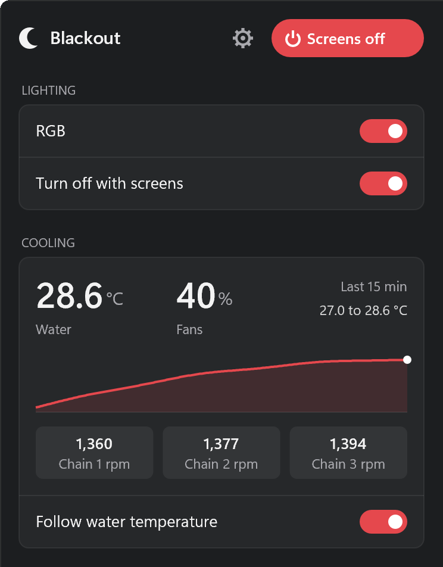
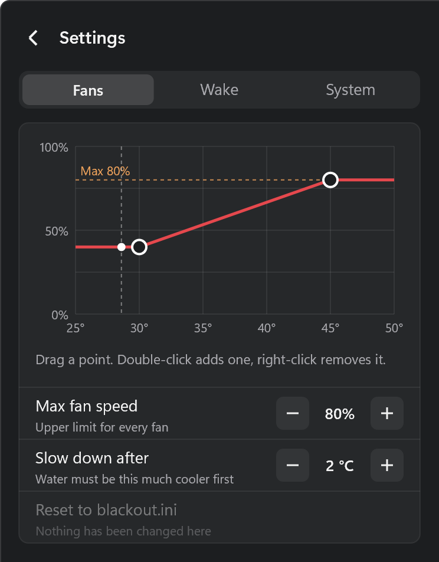
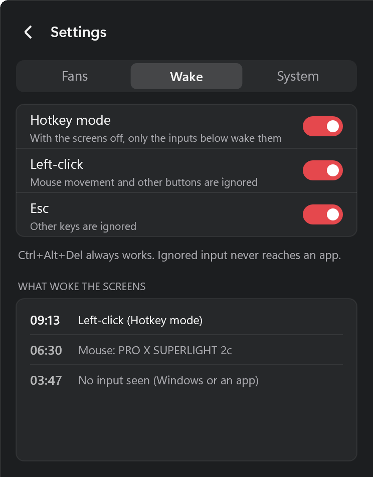
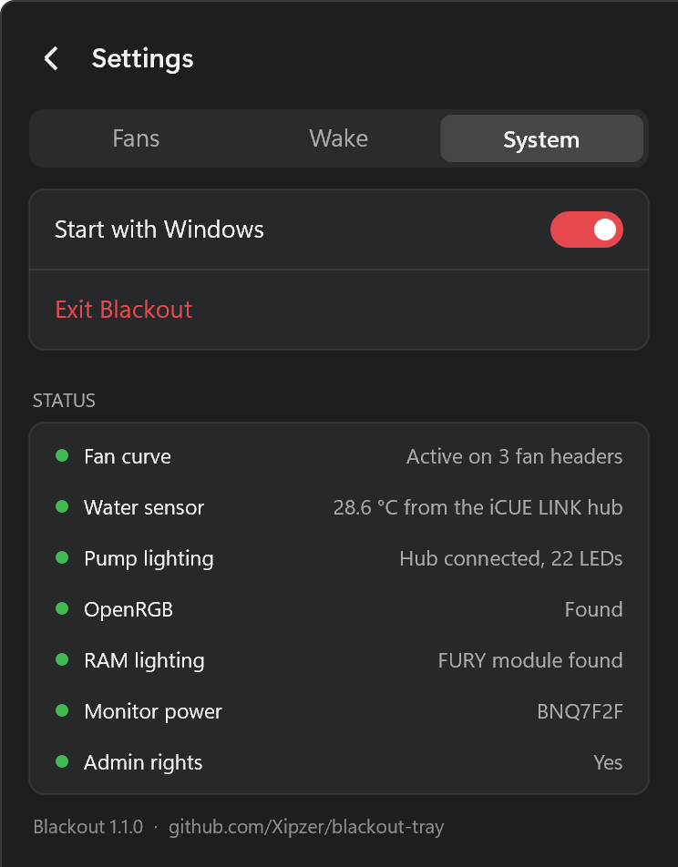

# Blackout

A tiny Windows tray app. Click it and every screen turns off. Lighting, fans, monitor power and window positions follow the screens.

## What it does

| Screens off | Screens on |
|---|---|
| RGB off | RGB back on |
| Fans to the "screens off" speed | Fans to the "screens on" speed |
| Listed monitors powered off over DDC/CI | Those monitors powered on |
| Window positions saved | Windows put back where they were |

This works for a Blackout click and for Windows' own display timeout.

**Left-click** the icon: screens off.
**Right-click**: the Blackout panel. It sits flush against the taskbar and the screen edge like the system tray menus, and takes its colour from your taskbar.

<p>


</p>
<p>


</p>

- **Main:** Screens off, RGB, turn RGB off with the screens. With a fan curve: the temperature, fan speed, a 15 minute graph, RPM per fan and the curve on/off switch.
- **Settings > Fans:** the fan curve (drag a point, double-click to add one, right-click to remove one), max fan speed, how far the temperature must drop before fans slow down, reset.
- **Settings > Wake:** Hotkey mode, and a list of what woke the screens last, with the device behind it.
- **Settings > System:** Start with Windows, Exit, and a status list of what Blackout found on this PC.

Esc goes back or closes the panel. If Direct2D is unavailable, a plain menu appears instead. Hover the tray icon for the temperature and fan speed.

RGB set to off stays off: waking the screens only brings the lighting back if the RGB switch is on.

## Supported hardware

| Feature | Hardware | Needs |
|---|---|---|
| RGB | Anything [OpenRGB](https://openrgb.org) supports | OpenRGB portable |
| Pump/fan RGB | Corsair iCUE LINK System Hub (XD5, QX, LX...) | Nothing |
| RAM RGB | Kingston FURY DDR5 | FURY module + Kingston FURY CTRL |
| Fan speed | Corsair Commander Pro | Nothing |
| Fan curve | Motherboard fan headers and USB fan controllers, from the files in [`devices`](devices) | For motherboard headers: PawnIO, `LpcIO.bin`, run as admin |
| Monitor power | Any monitor with DDC/CI | Nothing |

Every feature is optional. Missing hardware is skipped.

## Install

1. Download the release from [Releases](../../releases) and unzip it into a folder, for example `%LOCALAPPDATA%\Blackout`. Keep the `devices` folder beside `blackout.exe` if you use the fan curve.
2. Copy `blackout.example.ini` there as `blackout.ini` and edit it. No ini means screens off and fans only.
3. Run `blackout.exe`. Right-click the icon and tick **Start with Windows**.

For RGB, also unzip [OpenRGB](https://openrgb.org/releases.html) portable to the path in `blackout.ini`.

## Fan curve

One temperature drives up to 7 fans along a curve you draw in the panel. The usual setup is a water loop: the coolant sensor on an iCUE LINK hub sets the speed of radiator fans on motherboard headers.

1. For motherboard headers, install [PawnIO](https://pawnio.eu) and put `LpcIO.bin` (from PawnIO.Modules or OpenRGB) beside `blackout.exe`.
2. Run `blackout.exe --devices` as admin. It lists the fans and temperatures it can see.
3. Add `[fans]` to `blackout.ini` with `outputs=` and, unless you use the iCUE LINK coolant sensor, `source=`.
4. Run Blackout as admin and tick **Start with Windows**. As admin this creates a logon task, so there is no UAC prompt at login.

Edit the curve in the panel (Settings > Fans): drag a point, double-click the chart to add one, right-click a point to remove it, and set max fan speed and the slow-down margin. Changes apply at once and are kept in `HKCU\Software\Blackout` (`Curve`, `FanMax`, `Hysteresis`), which override the ini. **Reset to blackout.ini** drops them.

Fans go up straight away and come down after the hysteresis. Motherboard fans go back to the BIOS curve when the temperature reading is lost for 20 s, on exit, sleep and shutdown, and when the curve is switched off. Set a sensible fixed speed or curve in the BIOS: it is what runs whenever Blackout does not.

### Hardware

Each fan chip or controller is described by a text file in [`devices`](devices). [docs/devices.md](docs/devices.md) explains the format and how to add one.

| Hardware | Files | Fan control |
|---|---|---|
| Nuvoton NCT6779D, NCT6791D to NCT6799D | 10 | Yes. NCT6796D-R is verified, the rest are untested |
| ITE IT8603E to IT8698E, IT8728F, IT8792E, IT87952E | 15 | Yes, untested |
| ITE IT8790E, Fintek F718xx and F818xx, Nuvoton NCT6683D to NCT6687D | 20 | Speeds and temperatures only |
| Corsair Commander Pro | 1 | Yes, untested |
| NZXT Kraken X42 to X72, Aquacomputer D5 Next, Quadro, Octo, Farbwerk | 6 | Speeds and temperatures only |

Untested means the file was written from other open source drivers and has not been run on that hardware. Blackout will not control fans through it until you set `untested=1`. If it works for you, a pull request that marks it verified helps the next person.

An older `blackout.ini` with `channels=1,3,4` keeps working: it means `outputs=sio/2,sio/4,sio/5`.

## Hotkey mode

A bumped mouse or a vibrating desk can wake the screens in the middle of the night. With **Hotkey mode** on (panel > Settings > Wake), only the chosen inputs wake them while they are off:

- **Left-click** and/or **Esc** (at least one stays on)
- Mouse movement, other buttons and other keys are ignored, and don't reach any app
- **Ctrl+Alt+Del** always works

It applies whenever the screens go off, from Blackout or from Windows' own display timeout. Nothing runs for it while the screens are on.

The same tab lists the last few wakes and the device behind each one (for example `Mouse: PRO X SUPERLIGHT`), with or without Hotkey mode. Use it to find a device that keeps waking the screens.

## Configuration

`blackout.ini` sits beside `blackout.exe`. See [blackout.example.ini](blackout.example.ini).

| Section | Key | Meaning |
|---|---|---|
| `[rgb]` | `openrgb` | Path to `OpenRGB.exe`. Empty skips OpenRGB. |
| | `off`, `on` | OpenRGB arguments for each state |
| | `off2`..`off4`, `on2`..`on4` | Extra steps. Use for devices that are sometimes missing (wireless, speakers). |
| | `color` | Hex colour for the iCUE LINK hub and RAM when on |
| `[link]` | `leds` | LED count on the iCUE LINK chain. 0 disables it. |
| `[ddc]` | `monitors` | Monitor hardware IDs to power off, comma separated (e.g. `BNQ7F2F`) |
| `[fans]` | `outputs` | Fans to drive, e.g. `sio/2,sio/4` (see [Fan curve](#fan-curve)) |
| | `source` | Temperature to follow: `link` (default) or e.g. `sio/AUXTIN2` |
| | `untested` | `1` allows control through a definition marked untested |
| | `max` | Cap on every duty in % (default 100) |
| | `names` | Panel labels for the fans, in the order of `outputs`, e.g. `Top,Side,Bottom` |
| | `curve` | `C:duty` points, e.g. `30:40,45:100` |
| | `hysteresis` | C the temperature must drop before fans slow down (default 2) |

Fan speeds and toggles are set from the tray menu and kept in `HKCU\Software\Blackout`.

To find a monitor's hardware ID: Device Manager > Monitors > Properties > Details > Hardware Ids.

## FURY module (optional)

For Kingston FURY DDR5 RGB only. OpenRGB can't detect some of these kits, so this talks to Kingston's own service instead.

1. Install Kingston FURY CTRL. Its background service does the hardware access.
2. Put `furyled.exe` beside `blackout.exe`. Delete it to turn the module off.

Test it: `furyled off` or `furyled FF0000`.

## Resource use

Measured on Windows 11.

| Process | When | Memory | CPU |
|---|---|---|---|
| `blackout.exe` | Always | 0.2 to 0.4 MB | 0% idle |
| iCUE LINK keep-alive | Every 4 s, only with `[link]` | 5 small USB transfers | ~0% |
| Fan curve | Same 4 s tick, only with `[fans]` | One temperature read; fan write only when the duty changes. Only the definitions in use are kept, about 2 KB each | ~0% |
| Panel | Only while open | Opens in about 15 ms, about 15 MB while open, drawn on the CPU so no graphics driver is loaded | Brief |
| `OpenRGB.exe` | 3 to 5 s per change, then exits | ~100 MB while running | Brief |
| `furyled.exe` | Under 1 s per change | ~10 MB while running | Brief |
| Kingston FURY CTRL service | Always, if installed | ~40 MB | Kingston's |

## Setup notes

- **OpenRGB with Corsair Commander Pro or Lighting Node Pro:** set each channel's LED count once in OpenRGB (Zone Initialization). Static mode won't light a zone of size 0.
- **OpenRGB with an iCUE LINK hub:** disable OpenRGB's "Corsair iCUE Link System Hub" detector. Blackout drives the hub itself.
- **Screens off** briefly sets the Windows display timeout to 1 second, then restores your value.

## Build

Needs [zig](https://ziglang.org) and Python 3 with Pillow.

```sh
./build.sh            # checks devices/ on simulated hardware, then builds build/blackout.exe
```

FURY module, on Windows: `modules\fury\build.cmd`.

## License

[PolyForm Noncommercial 1.0.0](LICENSE.md). Free to use, change and share. Not for sale.

## Credits

Protocol details from [OpenRGB](https://gitlab.com/CalcProgrammer1/OpenRGB) (iCUE LINK) and [liquidctl](https://github.com/liquidctl/liquidctl) (Commander Pro). Device definitions are written from the Linux hwmon drivers, [LibreHardwareMonitor](https://github.com/LibreHardwareMonitor/LibreHardwareMonitor) and liquidctl. Port access is through [PawnIO](https://pawnio.eu).
